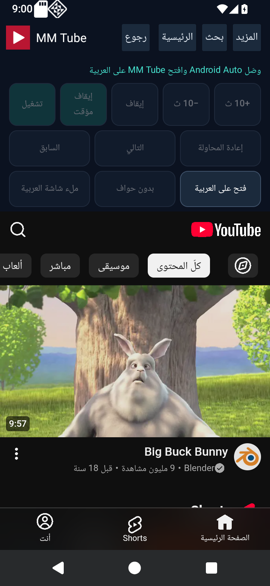
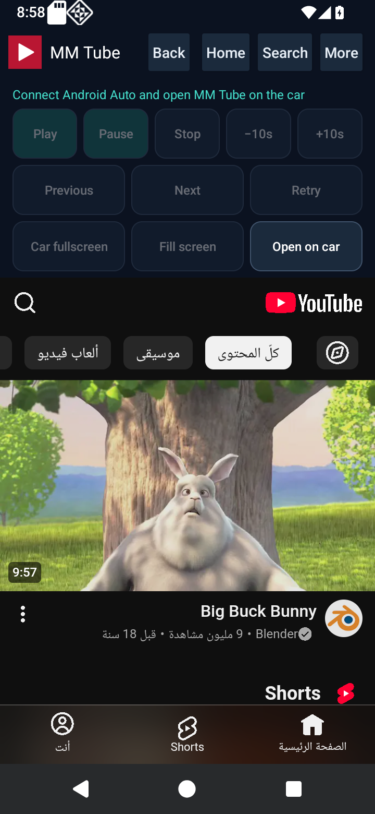

# MM Tube

[English](README.md) · **[تحميل MM Tube](https://github.com/moustafamagdi/MagdiTube/releases/latest)** · [التثبيت من MM Auto](https://github.com/moustafamagdi/MM-Auto)

تصفّح يوتيوب من الموبايل، واختار الفيديو وتحكّم في تشغيله على شاشة Android Auto. الموبايل ريموت فقط؛ الصورة والصوت يشتغلان على العربية.

## التحكم من الموبايل

| التحكم بالعربي | التحكم بالإنجليزي |
| --- | --- |
|  |  |

## المميزات

- البحث والتصفح في يوتيوب من الموبايل.
- تشغيل وإيقاف مؤقت وإيقاف، وتقديم أو رجوع عشر ثوانٍ، والتنقل للفيديو التالي أو السابق عند توفره.
- عرض الفيديو الحالي ووقت التشغيل وحالة اتصال العربية.
- الاختيار بين الصورة كاملة أو ملء مساحة العرض مع قص الأطراف.
- إظهار أزرار الفولسكرين بلمسة، واختفاؤها تلقائيًا أثناء المشاهدة.
- استمرار الصوت عند مغادرة واجهة المشغّل مؤقتًا، مع تفعيل صوت الخلفية.
- تحكم بالعربي والإنجليزي وكيبورد بحث على شاشة العربية.
- مانع إعلانات مفعّل افتراضيًا ويمكن إيقافه؛ قد لا يمنع كل الإعلانات.

## البداية

1. ثبّت التطبيق من **MM Auto** أو حمّل ملف **APK** من أحدث إصدار. يحتاج أندرويد 11 أو أحدث.
2. وصّل Android Auto وافتح **MM Tube** على شاشة العربية.
3. تصفّح من الموبايل واختار الفيديو. زر **فتح على العربية** يطلب فتح الواجهة إذا كان جهازك يدعم ذلك.
4. تحكّم من الموبايل أو شاشة العربية. لو مشغّل العربية غير متاح، لن يبدأ التشغيل على الموبايل.

أيقونة **MM Tube Audio** للتحكم في التشغيل الموجود على العربية. لو التطبيق الأساسي مش ظاهر في Android Auto، استخدم دليل الإعداد داخل MM Auto. التوافق يختلف حسب الجهاز والعربية، وتسجيل الدخول إلى يوتيوب قد لا يعمل على كل الأجهزة.

ثبّت التحديث فوق النسخة الحالية للاحتفاظ بالإعدادات.

## المساعدة والخصوصية

من **المزيد ← الدعم والتشخيص** يمكنك نسخ رقم الدعم أو إرسال تقرير. يمكنك إيقاف التقارير التقنية التلقائية من نفس الصفحة؛ التقارير لا تشمل كلمات المرور أو محتوى المشاهدة.

[الإبلاغ عن مشكلة](https://github.com/moustafamagdi/MagdiTube/issues/new) · [تفاصيل الخصوصية](SUPPORT.md) · [MM IPTV](https://github.com/moustafamagdi/MagdiIPTV)

مشروع مستقل غير تابع لـYouTube أو Google أو Android Auto.
