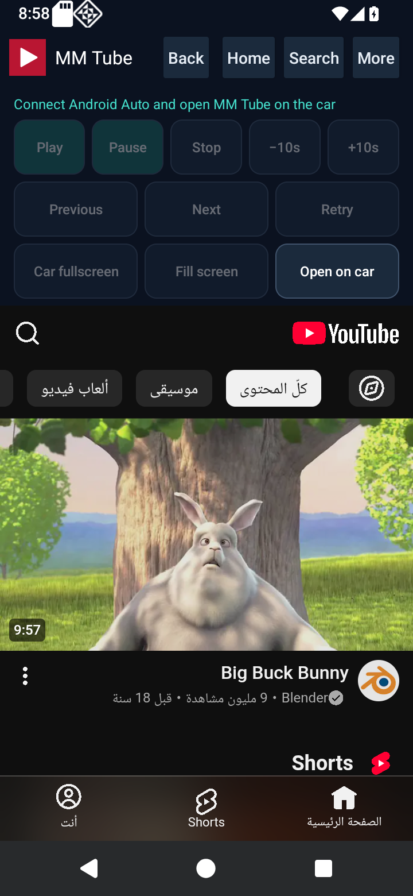
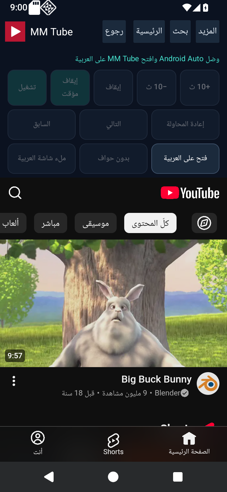

# MM Tube

[العربية](README.ar.md) · **[Download MM Tube](https://github.com/moustafamagdi/MagdiTube/releases/latest)** · [Install with MM Auto](https://github.com/moustafamagdi/MM-Auto)

Browse YouTube on your phone, then choose and control videos on your Android Auto screen. The phone is a remote controller; video and sound play on the car.

## Phone controller

| English controls | Arabic controls |
| --- | --- |
|  |  |

## Features

- Search and browse YouTube from your phone.
- Play, pause, stop, seek and skip back or forward ten seconds; next/previous appear when supported.
- See the current video, progress and car connection status.
- Switch between the full picture and a screen-filling view, which crops the edges.
- Reveal fullscreen controls with a tap; they fade away while you watch.
- Keep audio playing when temporarily leaving the car player, with background audio enabled.
- Arabic and English controls, plus an on-screen search keyboard on the car.
- Ad assistance enabled by default, with an off switch. It may not block every ad.

## Get started

1. Install through **MM Auto**, or download the **APK** from the latest release. Android 11 or later is required.
2. Connect Android Auto and open **MM Tube** on the car screen.
3. Browse on the phone and choose a video. **Open on car** can request the car interface when supported.
4. Use the phone or car controls. Without an available car player, nothing plays on the phone.

The **MM Tube Audio** entry provides controls for existing car playback. If the main app is missing from Android Auto, use MM Auto's setup guide. Availability varies by device and car. YouTube sign-in may not work on every device.

Install updates over your current app to keep its settings. Use video while parked.

## Help and privacy

Open **More → Support & diagnostics** to copy your Support ID or send a report. Automatic technical reports can be turned off there; they do not include passwords or watched content.

[Report an issue](https://github.com/moustafamagdi/MagdiTube/issues/new) · [Privacy details](SUPPORT.md) · [MM IPTV](https://github.com/moustafamagdi/MagdiIPTV)

Independent project, not affiliated with YouTube, Google or Android Auto.

[Development notes](docs/DEVELOPMENT.md) · [Third-party notices](THIRD_PARTY.md)
